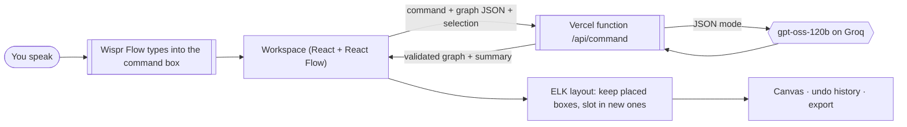

# Voicegraph 🎙️→📐

**Say the system. Shape it by hand.**

🔗 **Live:** https://voicegraph-mocha.vercel.app · **Workspace:** https://voicegraph-mocha.vercel.app/app

Voicegraph is a voice-first architecture whiteboard. Hold your [Wispr Flow](https://wisprflow.ai) key and describe a system the way you'd explain it to a teammate. Voicegraph draws it as a diagram you can drag around. Then:

- keep talking to change it,
- select a box and say "make this red" or "connect this to Stripe",
- ask for an **architecture review** that flags weak spots on the boxes involved,
- get a **README architecture section** written from the diagram,
- export PNG, SVG or a Mermaid block that GitHub renders natively.

Built for **No Hands: The Wispr Challenge** (WeMakeDevs × Wispr Flow), Builders track. It was built entirely by voice.

## The problem

I build hackathon projects, and every README, design doc and pitch needs an architecture diagram. Drawing one in draw.io means 20–30 minutes of dragging boxes for something I can explain in 30 seconds. Then nobody writes the "Architecture" section, and nobody checks the design for obvious holes.

Voicegraph makes the explanation the diagram, and the diagram the docs.

## What it does

| | |
|---|---|
| **Voice-first editing** | Dictation from Wispr Flow runs by itself the moment it lands. It follows self-corrections ("no wait, Kafka"). |
| **Selection-aware voice** | Click a box (Shift-click for more) and say "this" or "these". The AI knows what you mean. |
| **Ask questions** | "What happens if Redis goes down?", "Explain this diagram". The AI answers without touching the diagram. |
| **Review, then "fix them"** | After a review, say "fix them" or "fix the second one" and the AI changes the diagram to address those findings. |
| **Select and move by voice** | "Select all databases", "select the API and Redis", "move this to the right", "move Redis up a bit". |
| **Manage diagrams by voice** | "New diagram called Chat app", "open the online store diagram", "rename this diagram to Checkout v2", "undo 3 times". |
| **Drag-and-drop canvas** | Smooth pan and zoom, drag boxes, drag from a dot to connect, double-click to rename, Delete to remove, minimap, groups that follow their boxes. |
| **Stable layout** | Boxes you've placed stay put when the AI edits. New boxes slot in beside their neighbours. "Tidy up" re-arranges everything with an animation (ELK layered layout). |
| **Architecture review** | Finds single points of failure, direct DB access, sync calls to slow third parties and missing auth or observability. Pins each finding to the boxes involved: click a finding to jump there. |
| **README writer** | Overview, components and data flow, written from the diagram, with the diagram embedded as Mermaid. |
| **Instant commands** | "undo", "redo", "tidy up", "fit to screen", "start over", "download PNG", "copy for README", "share it", "review my architecture", "delete this". These run locally, with no AI call. |
| **Share links** | The whole diagram is compressed into the URL. No server storage. |
| **Many diagrams** | Saved in your browser, switchable from the title menu. |
| **Sample to fix** | Opens on a deliberately flawed online-store diagram, so judges can try it in seconds. |

## How it works



- **Model of the diagram:** a small JSON graph (nodes with kind, tech, colour and group; edges with label and style). `shared/graph.js` validates every graph from the model or a share link, and converts it to Mermaid.
- **API:** one serverless function (`api/command.js`) with three modes: `edit`, `review` and `docs`. It holds the Groq key, uses JSON mode, sanitises the output, retries once on brief rate limits, and rate-limits each visitor.
- **Frontend:** Vite + React, with [React Flow](https://reactflow.dev) for the canvas, [elkjs](https://github.com/kieler/elkjs) for layout (lazy-loaded), html-to-image for export and lz-string for share links. Fonts are self-hosted.

## Run it locally

Requires Node 20+.

```bash
npm install
cp .env.example .env.local   # paste your Groq key (free at https://console.groq.com/keys)
npm run dev                  # http://localhost:3000 (landing) and /app (workspace)
```

The Vite dev server also serves `/api/command`, using the same handler that runs on Vercel.

## Deploy to Vercel

1. Push to GitHub and import the repo in Vercel. The Vite preset is detected automatically.
2. Add `GROQ_API_KEY` (and optionally `GROQ_MODEL`) under Project → Settings → Environment Variables.
3. Deploy. `vercel.json` turns on clean URLs, so the workspace lives at `/app`.

## How I used Wispr Flow

Every prompt to my AI coding assistant, every follow-up and this README were dictated with Wispr Flow. The app is also built around it: Wispr Flow is the input device. You hold Fn, speak and let go, and the diagram changes.

## Project structure

```
index.html              landing page
app.html                workspace entry
src/App.jsx             workspace: canvas, sidebar, voice loop, undo, export
src/components/nodes.jsx  draggable box and group nodes
src/layout.js           ELK auto-layout + "keep what you placed" placement
src/commands.js         instant voice commands and suggestions
src/storage.js          saved diagrams, sample, share links
shared/graph.js         graph validation + Mermaid export (browser and API)
api/command.js          serverless AI endpoint: edit / review / docs
```
